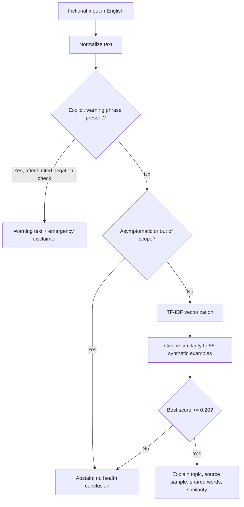

# HealthLens AI

**Student:** José Miguel Tuozzo Izaguirre  
**Course:** ITAI-2372 — Artificial Intel Applications  
**Professor:** Srikanth Bhakthan  
**Assignment:** Module 03 — AI in Healthcare  
**Repository:** https://github.com/jtuozzo1616/HealthLens-AI-Explainable-Symptom-Analysis

**An explainable, safety-conscious NLP classroom application**

> **Classroom demonstration, NOT clinical software.** Use fictional symptom stories only. HealthLens AI does not diagnose, rule out a problem, reliably determine urgency, replace clinicians, or provide treatment. It is not authorized, validated, or intended for medical decisions.

HealthLens AI is a working **Gradio web application** that categorizes the *language* of a fictional symptom description using **TF-IDF + cosine similarity**, checks for a limited number of explicit emergency-warning phrases using an **interpretable safety layer**, and **abstains** when the small training set cannot support a match. All model examples are **original, synthetic sentences**. No account, API key, internet call to an LLM, patient database, or model download is needed for inference.

## 1. Demonstration

| Input (fictional) | Prototype output | Why |
| --- | --- | --- |
| `My eyes are watery and itchy.` | Eye and nose irritation | Similarity to fictional eye/nose examples |
| `I have an itchy red rash on my hand.` | Skin irritation or itching | Nearest synthetic skin example |
| `I have chest pain and a cough.` | Warning language detected | Explicit warning rule overrides ML classification |
| `No chest pain, but I cannot breathe.` | Warning language detected | Negated first phrase does not negate the second clause |
| `I feel fine and have no symptoms.` | Unable to classify reliably | Explicitly asymptomatic text must not receive a disease-related topic |
| `My favorite movie is funny.` | Unable to classify reliably | No adequate match to this small dataset |

**Important distinction:** A topic label is **not a possible diagnosis**, a **risk level**, or an assurance that medical attention is unnecessary. The returned cosine similarity value is **not a medical probability**.

## 2. Quick start

Requirements: **Python 3.11+**, macOS/Windows/Linux, internet access **once** to install packages (unless already installed).

```bash
# From the repository root, create an isolated environment.
python -m venv .venv

# macOS / Linux
source .venv/bin/activate

# Windows PowerShell (use this instead of source)
# .venv\Scripts\Activate.ps1

pip install -r requirements.txt
python app.py
```

Open **http://127.0.0.1:7860** if the browser does not open automatically. Only use fictional scenarios. Stop the application using Ctrl+C.

### Run tests and evaluation

```bash
pip install -r requirements-dev.txt
python -m pytest -q
python evaluate.py
```

The evaluation reports scores *only for the included synthetic cases*. No patient data, clinical test sets, demographic subgroup tests, or medical gold standard were used.

## 3. Background research and motivation

The chosen innovation is **explainable language processing for initial analysis of patient-reported symptom text**. Real-world symptom checker systems can increase access to information, but validation and transparency are particularly important because an inaccurate result may mislead a user.

- **Peer-reviewed evidence:** Riboli-Sasco et al. (2023) reviewed **14 studies** of online symptom checkers. They reported variable and frequently suboptimal diagnostic/triage performance and urged further validation before widescale adoption [1]. The finding motivates separating **text understanding** from **medical decision-making** here.
- **Emergency-warning background:** NIH MedlinePlus explains warning signs associated with medical emergencies [2]. HealthLens does **not** ingest or scrape that webpage; the developer-authored toy patterns are intentionally incomplete and used only as a **classroom safety illustration**, not a comprehensive medical protocol.
- **Responsible AI:** The WHO warns about inaccurate information, bias, privacy, cybersecurity, and automation bias in AI health systems [3]. HealthLens addresses a narrow subset: traceable model outputs, abstention, obvious warnings, and no intentional storage of user input.
- **Regulatory context:** The U.S. FDA's January 2026 guidance explains that some clinical decision support software may still meet the definition of a medical device, especially depending on users and intended use [4]. This project is not assessed for medical-device regulatory status and is **strictly educational**, not offered for clinical use.

**Research question:** Can a compact, explainable NLP system map *synthetic English descriptions* into symptom-language topics while prioritizing explicit emergency-warning phrases and declining out-of-scope queries?

**Scope:** Student learning and reproducibility. The project does not claim to answer how accurately actual illnesses are diagnosed or what care real people require.

## 4. How the NLP works



**Dataset construction:** Seven topics × eight fictional training sentences = **56 examples** written for this project. They were not generated from or scraped from patient records or copyrighted healthcare webpages. Each topic is a *language family*:

1. Cough/throat/nasal (`respiratory`)
2. Head pain (`headache`)
3. Digestive discomfort (`digestive`)
4. Skin irritation (`skin`)
5. Muscles/joints (`musculoskeletal`)
6. Urination (`urinary`)
7. Eye/nose irritation (`eye_nose_allergy`)

The ML component uses **scikit-learn TfidfVectorizer** with lowercase processing, Unicode normalization, English stop-word removal, unigram/bigram features, and sublinear term frequency. The training examples become vectors in a vocabulary learned *from data*, and cosine similarity selects the nearest original example. The **0.20 threshold** is an uncalibrated illustrative cutoff, not a clinically optimized threshold. It must not be represented as diagnostic sensitivity or patient confidence.

This is **retrieval-based NLP/feature learning**, not a generative model or fine-tuned LLM. TF-IDF fits its feature weights to training text; cosine similarity ranks candidates. The warning detector is a transparent, separate, **rule-based** system. Choosing a small explainable model makes it possible to show the matching training example and score without internet/API costs or medical hallucinations. Option 2 permits Python/NLP instead of requiring an LLM.

**Preprocessing:** `normalize_text()` applies Unicode normalization and whitespace cleanup; a narrow negated-warning phrase cleanup prevents e.g. `no chest pain` from dominating a back-pain topic match; scikit-learn handles English tokenization, lowercase normalization, and stop words. There is no NLTK download or separate lemmatization requirement for this application. Short example phrases are intentionally diverse; lack of stemming/lemmatization is a documented limitation.

**Safety decision:** The warning layer runs first, before cosine similarity. It recognizes a limited number of expressions such as chest pain, difficulty breathing, or bleeding that cannot be stopped. It includes a local English negation heuristic so `no chest pain` does not automatically trigger the same phrase, but complex grammar is not understood reliably. **A warning match may indicate an emergency; a missed match never indicates safety.** In the U.S., the app mentions 911 for emergencies and 988 for crisis support as appropriate. This is general safety information, not clinical triage.

## 5. Testing and reproducibility

Files:

```text
Repository root/
├── app.py                       # Gradio web app; comments and user-facing disclaimers
├── healthlens/
│   ├── __init__.py
│   └── engine.py                # NLP, safety-pattern rules, transparent output
├── data/
│   ├── synthetic_examples.json  # 56 fictional training sentences developed for this project
│   └── evaluation_cases.json   # 26 separate fictional evaluation scenarios
├── tests/
│   ├── test_engine.py           # Safety, negation, input bounds, NLP, abstention
│   └── test_evaluation.py       # Evaluation reproducibility / structure
├── evaluate.py                  # Synthetic benchmark, not clinical evaluation
├── PROJECT_REPORT.md            # Research, methods, interpretation, ethics
├── PROJECT_REPORT.pdf           # Three-page printable academic report
├── EVALUATION_REPORT.md         # Tested measurements and limitations
├── PEER_REVIEW_GUIDE.md         # Instructions for anonymous reviewers
├── SUBMISSION_GUIDE.md          # GitHub and LMS submission instructions
├── requirements.txt
├── requirements-dev.txt
├── .github/workflows/python-tests.yml
└── LICENSE
```

The project evaluation set contains **26** separate, fictional scenarios. Cases were hand-authored rather than collected from patients. No cross-validation or independently annotated clinical dataset is claimed. Unit tests check implementation behavior including negated warnings, warnings in new clauses, seven-topic structure, explainability, empty input, and abstention.

Results for the fixed synthetic set, verified locally using Python 3.13 and scikit-learn 1.8.0:

| Toy evaluation measure | Result | Definition |
| --- | ---: | --- |
| Warning phrase recall | 100% | Correctly flagged the 8 hand-authored warning cases |
| Warning phrase specificity | 100% | Did not flag the 18 other toy cases |
| Topic label accuracy | 100% | Correct category on 16 expected-topic cases |
| Unknown-case abstention | 100% | Abstained for 2 intentionally irrelevant/asymptomatic cases |

These are **unit/functional benchmark results on a very small synthetic test**, **not** externally valid claims. Performance on unexpected text, demographics, dialects, other languages, or real clinical symptoms may be far worse. Dataset examples were developed for this project with AI assistance, so evaluation is susceptible to dataset-design bias and lexical similarity to training samples.

## 6. Ethics, safety, and privacy

**Patient safety:** No diagnosis, no medications/dosages, no advice to stay home, no claim that a symptom is benign, no "all clear" outcome. An unknown result abstains. A detected emergency phrase displays a high-salience warning while disabling topic classification in that invocation.

**Privacy:** This application has no database and includes no code to persist entered text, keep user records, use analytic trackers, or send entered text to external AI APIs. It is explicitly **not HIPAA-compliant by assertion**. Gradio and hosting services could keep logs/metadata. A public instance would require threat modeling, consent design, retention audits, access control, and a privacy review. **Do not enter personal medical information.**

**Bias and inclusion:** Fictional examples are short, English-only, and limited to seven categories. They do not represent children, pregnancy, disability, older adults, rare conditions, regional language, or multiple diseases. Because no demographic labels are collected, subgroup fairness cannot be measured. Do not deploy this tool to patients.

**Model transparency:** No black-box medical diagnosis; nearest training sentence and shared tokens are displayed. Cosine similarity is explicitly marked as **similarity, not confidence or medical probability**. There are no clinical performance claims.

**Failure modes:** Negation scope errors; sarcasm; misspellings; abbreviations; false positives/false negatives; compound symptoms; new conditions; unrecognized warning phrases; token overlap despite semantic mismatch; dataset imbalance; and English-only processing.

**Before any real-world medical use:** clinicians must define intended use and risk thresholds, independently validate on representative clinically adjudicated data, test failure modes and fairness, perform security/privacy reviews, ensure appropriate human oversight, assess FDA/regulatory requirements, and monitor outcomes. This class project is not a substitute for those steps.

## 7. Ethical use of AI during development

ChatGPT assisted with ideation, code generation, development of fictional examples and test cases, testing, and documentation, as permitted by this assignment. The application itself does not send symptom text to an external AI model. The submitted code is available for inspection, and the student is responsible for reviewing, running, understanding, and explaining the result. The synthetic examples and expected test labels were created for this classroom project, not collected from patients.

**Academic integrity:** Before submitting, personally execute the tests, inspect the code and report, and make only truthful claims about your contributions.

## 8. Peer-review demonstration (3–5 minutes)

1. Run `python app.py`. Explain that this is fictional, nonclinical, and English-only.
2. Show an eye/nose or skin example and its nearest synthetic sentence plus cosine similarity.
3. Show a chest-pain example and explain that the warning phrase is detected before ML topic retrieval.
4. Show `No chest pain, but I cannot breathe.` and explain limited negation plus clause splitting.
5. Show `I feel fine and have no symptoms.` and explain abstention.
6. Run `python -m pytest -q` and `python evaluate.py`, and stress that synthetic scores are not clinical validation.
7. Show the research and safety limitations in `PROJECT_REPORT.md` and `EVALUATION_REPORT.md`.

## 9. Sources (publications and guidance, **not** a scraped dataset)

[1] Riboli-Sasco, E., et al. (2023). *Triage and Diagnostic Accuracy of Online Symptom Checkers: Systematic Review*. **Journal of Medical Internet Research, 25**, e43803. https://doi.org/10.2196/43803 ; https://pubmed.ncbi.nlm.nih.gov/37266983/

[2] U.S. National Library of Medicine / MedlinePlus. *Recognizing medical emergencies* (reviewed Jan. 8, 2025). https://medlineplus.gov/ency/article/001927.htm (background reading only; not ingested into the app or used as a training dataset).

[3] World Health Organization. (2024). *WHO releases AI ethics and governance guidance for large multi-modal models.* https://www.who.int/news/item/18-01-2024-who-releases-ai-ethics-and-governance-guidance-for-large-multi-modal-models

[4] U.S. Food and Drug Administration. (Jan. 2026). *Clinical Decision Support Software — Guidance for Industry and FDA Staff.* https://www.fda.gov/regulatory-information/search-fda-guidance-documents/clinical-decision-support-software
